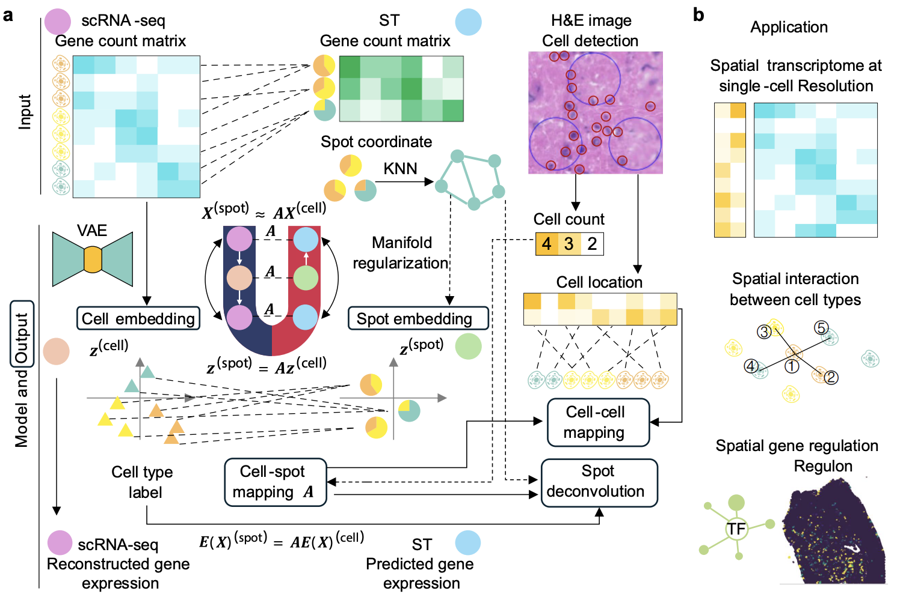

# Deeply Mapping Cell and Spot in Joint Latent Space

scMagnet is a deep learning framework designed to bridge the technological gap between scRNA-seq and spatial transcriptomics (ST) by reconstructing genome-wide spatial transcriptomes at single-cell resolution. Utilizing a robust triple alignment strategy across count and latent spaces—guided by manifold regularization—our method accurately maps scRNA-seq cells to ST spots and directly to detected cells in tissue images. The framework takes standard scRNA-seq and spatial data as input to output high-fidelity cell-to-spot mappings. Beyond spatial reconstruction, scMagnet empowers downstream analyses, including the precise estimation of spatial gene regulation patterns and the identification of key regulatory modules across different biological conditions.

## 📌 Overview

  

Single-cell RNA-seq (scRNA-seq) captures gene expression at high resolution but loses spatial context, while spatial transcriptomics (ST) retains tissue architecture but at lower cellular resolution. This project bridges the two modalities by learning a **joint embedding** where cells from scRNA-seq and spots from ST are mapped to a common latent space. The learned representations can be used for:

- Aligning cell types with spatial locations
- Predicting unmeasured gene expression in spatial data
- Integrating multiple datasets across technologies

---

## 🛠️ Environment Setup

Follow the steps below to set up the environment for `scMagnet`.

### 1. Create and Activate the Conda Environment

First, create a new Conda environment named `scMagNet` with Python 3.10, and then activate it:

```bash
conda create --name scMagNet python=3.10
conda activate scMagNet
```

### 2. Install PyTorch

Next, install PyTorch compatible with your CUDA version.

1. Visit the [PyTorch official installation page](https://pytorch.org/get-started/locally/).
2. Select the appropriate installation command based on your system and CUDA version.
3. For example, to install with CUDA 12.6, run:

```bash
pip3 install torch torchvision --index-url https://download.pytorch.org/whl/cu126
```

### 3. Verify the Installation

After installation, run the following Python code to verify that PyTorch is installed correctly and that your GPU is available:

```python
import torch 
print(torch.__version__) 
print(torch.cuda.is_available())  # Returns True if CUDA is installed and GPU is available
```

### 4. Install Remaining Dependencies

Finally, install the rest of the project dependencies using the provided `environment.yml` file:

```bash
conda env update -f environment.yml
```

---

## 📁 Repository Structure

- `JointEmbedding4.py` (or the merged `geo_dis + method_1` script): Main experiment script containing training, evaluation, and optimization flows.
- `DrawPicture2.py`: Visualization utilities for spatial plots and embeddings.
- `environment.yml`: Conda environment specification for reproducibility.
- `README.md`: This file.
- `20k_markers.npy`: Marker gene list used by some legacy scripts.
- `harmony_embedding.txt`: PCA/Harmony embedding guidance used by some legacy scripts.
- `spot_loc_with_counts_r_f.csv`: Legacy spot metadata used for adjacency and smoothing.
- `dataGithub/`: Directory containing input `.h5ad` and CSV files (see below).
- `ours/`: Output directory for prediction, embedding, and assignment matrices.
- `SimMerfish/ours/`: Output directory for Stage 1 checkpoint.
- `SpatialVG_improved_NMF/models/`: Output directory for Stage 2 checkpoint.
- `compare/`, `method/`: Additional folders for comparisons, auxiliary data, and notebooks.

---

## 📂 Input Data Format

The current merged script (e.g. `scMagNet_F2.ipynb`) expects the following files. **Paths are hard-coded in the script by default**; update them to your local paths if needed.

### Current example data (`dataGithub/`)

| File | Required | Format | Description |
|---|---|---|---|
| `dataGithub/adata_sc_mouse1sample1_mouse1_slice50_celltype.h5ad` | Yes | AnnData `.h5ad` | scRNA-seq reference data. `X` should be raw/non-negative counts; `obs['celltype']` is required for evaluation; `var_names` are gene symbols. |
| `dataGithub/adata_st_mouse1sample1_mouse1_slice50_drop.h5ad` | Yes | AnnData `.h5ad` | Spatial transcriptomics data. `X` should be raw/non-negative counts; `obsm['spatial']` must contain spot coordinates with shape `(n_spots, 2)`. |
| `dataGithub/spots_info1.csv` | Yes for Stage 1 | CSV | Must contain a column `n_cells`, one row per ST spot, in the same order as `adata_ST.obs_names`. Used by the density/row-sum regularization. |
| `dataGithub/spots_info2.csv` | Yes for Stage 2 | CSV | Same format as `spots_info1.csv`; used in the second training stage. |
| `dataGithub/spots_cells2.csv` | Optional, for assignment evaluation | CSV | Cell-to-spot ground truth. Must contain a column `spot_id`; the row index should be cell IDs matching `adata_sc.obs_names`. |
| `dataGithub/A_gt_simulationdata.csv` | Optional, for deconvolution evaluation | CSV | Ground-truth cell-type proportions. Rows are spot IDs; columns are cell-type names. |
| `dataGithub/geodesic_dist_sub.npy` | Yes if not recomputed | `.npy` | Square geodesic distance matrix for scRNA-seq cells, shape `(n_sc_cells, n_sc_cells)` or `(n_subsampled, n_subsampled)`. |

### Legacy data (optional, only used by some older scripts)

| File | Description |
|---|---|
| `scRNA_subsampled_20k.h5ad` | Subsampled scRNA-seq data. |
| `Visium_FAD.h5ad` | Visium spatial data. |
| `20k_markers.npy` | Marker gene list. |
| `harmony_embedding.txt` | Precomputed PCA/Harmony embedding guidance. |
| `spot_loc_with_counts_r_f.csv` | Spot metadata with coordinates and counts. |
| `S3_GT.txt` | Ground truth for a specific benchmark. |

> Large datasets are not included. Download them from:  
> https://drive.google.com/drive/folders/1Vf8iVi29hQqXOYWpDYSgmuAbWvS5l6XL?usp=sharing  
> Place them in a `data/` directory and modify the corresponding paths in the main script.

### AnnData requirements

**scRNA-seq AnnData:**
- `adata_sc.X`: raw or normalized non-negative expression matrix. The script calls `sc.pp.normalize_total(adata_sc)` and then applies `log1p` internally.
- `adata_sc.var_names`: gene symbols. Used to align scRNA-seq and ST data.
- `adata_sc.obs_names`: unique cell IDs. Must match the row index of `spots_cells2.csv` if assignment ground truth is evaluated.
- `adata_sc.obs['celltype']`: cell-type labels. Required for clustering and deconvolution evaluation.

**Spatial transcriptomics AnnData:**
- `adata_ST.X`: raw non-negative count matrix. The script applies `log1p` internally.
- `adata_ST.var_names`: gene symbols. When `fix_genes=True`, these must contain all genes in `common_genes`; otherwise the script will fail during subsetting.
- `adata_ST.obs_names`: unique spot IDs. Must match the row order of `spots_info1.csv`, `spots_info2.csv`, and the index of `A_gt_simulationdata.csv` when evaluation is enabled.
- `adata_ST.obsm['spatial']`: spot coordinates with shape `(n_spots, 2)`. Used for the spatial similarity graph and adjacency smoothing.

### File matching and ordering requirements

1. `spots_info1.csv` / `spots_info2.csv` must have the same number of rows as `adata_ST.n_obs`, and the `n_cells` column must be in the same order as `adata_ST.obs_names`.
2. `spots_cells2.csv` should be a cell-by-spot table: each row is a scRNA-seq cell, and the `spot_id` column indicates the spot it belongs to.
3. `A_gt_simulationdata.csv` should be a spot-by-cell-type table: rows are spot IDs, columns are cell-type names.
4. If `geodesic_dist_sub.npy` is precomputed with subsampling, the saved `sample_idx` must be consistent with the rows/columns of the distance matrix. In the current script, `sample_idx=np.arange(geodesic_dist.shape[0])` is used, so the distance matrix is assumed to cover all cells in order.

### Minimal input validation

Before running, we recommend verifying the inputs:

```python
import numpy as np
import pandas as pd
import scanpy as sc

adata_sc = sc.read_h5ad(sc_path)
adata_st = sc.read_h5ad(st_path)
spots_info = pd.read_csv("dataGithub/spots_info1.csv")

assert "celltype" in adata_sc.obs, "scRNA-seq obs['celltype'] is required."
assert "spatial" in adata_st.obsm, "ST obsm['spatial'] is required."
assert adata_st.obsm["spatial"].shape == (adata_st.n_obs, 2)
assert "n_cells" in spots_info.columns
assert len(spots_info) == adata_st.n_obs
assert np.all(spots_info["n_cells"].values >= 0)
```

---

## ⚙️ Parameters and Configuration

The main training function is:

```python
train_vae_poisson_model(
    sc_path, st_path, num_cell=None, output_dir='SpatialVG_improved_NMF',
    common_genes=None, embedding_dim=32, lr=0.05, epochs=500,
    lambda_g=1, lambda_reg=0, lambda_l2=0, lambda_l4=1, lambda_l5=0,
    lambda_ot=0, lambda_M=0, lambda_M1=0, lambda_r=0, lambda_kl=1e-4,
    lambda_pca=0, lambda_f=0, lambda_row_sum=0, n_top_genes=5000,
    z_pca=None, predictA=None, f_vals=None, z_cell=None,
    fix_genes=True, geodesic_dist=None, sample_idx=None,
    mapping_original=None
)
```

### Main training parameters

| Parameter | Default in example | Meaning | Notes |
|---|---:|---|---|
| `sc_path` | `dataGithub/adata_sc_...h5ad` | Path to scRNA-seq `.h5ad`. | `obs['celltype']` is required for evaluation. |
| `st_path` | `dataGithub/adata_st_...h5ad` | Path to ST `.h5ad`. | `obsm['spatial']` is required. |
| `common_genes` | `adata_sc.var_names` | Gene list used for alignment. | If `fix_genes=True`, these genes must exist in both datasets; if `fix_genes=False`, the script intersects with ST genes. |
| `fix_genes` | `True` | Whether to keep the provided `common_genes` fixed. | `False` will automatically take the intersection with ST `var_names`. |
| `n_top_genes` | `5000` | Number of HVGs used when `common_genes=None`. | In the current example `common_genes` is provided, so `n_top_genes` is effectively ignored. |
| `embedding_dim` | `32` | Latent embedding dimension for cells. | Used by encoder, decoder, and alignment MLP. |
| `lr` | `0.05` | Learning rate for AdamW. | Scheduler: `StepLR(step_size=50, gamma=0.8)`. |
| `epochs` | `500` | Maximum training epochs. | Early stopping patience is 200. |
| `predictA` | `None` | Stage flag. `None` trains encoder/decoder; `True` fixes `z_cell`/`f_vals` and optimizes assignment matrix `A`. | Key switch between Stage 1 and Stage 2. |
| `z_pca` | `None` | Optional PCA/embedding guidance for alignment loss. | If `None`, the script initializes assignment using kNN in PCA space. |
| `geodesic_dist` | loaded `.npy` | Geodesic distance matrix for scRNA-seq cells. | Used by `lambda_g` loss in Stage 1. |
| `sample_idx` | `np.arange(...)` | Indices of cells corresponding to `geodesic_dist`. | Must match the distance matrix. |
| `mapping_original` | `'original'` | Whether to apply inverse `log1p` before ZINB/Poisson loss in Stage 2. | `'original'` uses `exp(x)-1`; otherwise uses log-space values directly. |
| `num_cell` | from `spots_info*.csv` | Number of cells per ST spot. | Used by `lambda_row_sum` density regularization. |

### Loss weights

| Parameter | Meaning | Active in current loss? |
|---|---|---:|
| `lambda_g` | Weight of geodesic isometry loss between cell embedding distances and precomputed geodesic distances. | Yes, Stage 1 |
| `lambda_kl` | Weight of VAE KL divergence. | Yes, Stage 1 |
| `lambda_pca` | Weight of alignment loss between `align_mlp(z_cell)` and `z_pca`. | Yes, Stage 1 |
| `lambda_l4` | Weight of cosine reconstruction loss between decoded expression and scRNA-seq expression. | Yes, Stage 1 |
| `lambda_M` | Weight of cosine loss between predicted ST expression and observed ST expression. | Yes, Stage 2 |
| `lambda_M1` | Weight of zero-inflated Poisson/Poisson NLL reconstruction loss for ST expression. | Yes, Stage 2 |
| `lambda_row_sum` | Weight of row-sum density regularization using `num_cell`. | Yes, Stage 2 |
| `lambda_reg` | Weight of Gromov-Wasserstein distance loss in Stage 2. | Yes, Stage 2 |
| `lambda_f` | Weight of cell-size factor `f` regularization. | Yes if `lambda_f > 0` |
| `lambda_l2` | Reserved / legacy parameter. | No |
| `lambda_l5` | Reserved / legacy parameter. | No |
| `lambda_ot` | Reserved / legacy parameter. | No |
| `lambda_r` | Reserved / legacy parameter. | No |

> Note: `lambda_l2`, `lambda_l5`, `lambda_ot`, and `lambda_r` are kept for compatibility with previous experiments but are **not active** in the current merged loss. Set them to `0` unless you modify the loss function.

### Geodesic distance parameters

`compute_geodesic_distances_isomap(X, n_neighbors=15, n_components=10, sample_fraction=0.05)`

| Parameter | Meaning |
|---|---|
| `n_neighbors` | Number of nearest neighbors for the Isomap/kNN graph. Larger values produce smoother but less local distances. |
| `n_components` | Isomap embedding dimension used for acceleration. |
| `sample_fraction` | Fraction of cells used for distance computation. `1.0` means all cells. Use `0.05–0.1` for large datasets to reduce memory. |

### Assignment optimization parameters

`generate_optimized_A_softmax_normalized(A0, adj_matrix, lambda_reg=10.0, lr=0.05, epochs=1000)`

| Parameter | Meaning |
|---|---|
| `A0` | Initial spot-by-cell assignment/proportion matrix. |
| `adj_matrix` | Spatial adjacency matrix, shape `(n_spots, n_spots)`. |
| `lambda_reg` | Smoothness regularization weight on the normalized graph Laplacian. |
| `lr` | Adam learning rate for optimizing the unnormalized assignment logits. |
| `epochs` | Number of optimization iterations. |

> The current release uses script-level constants for paths and hyperparameters. For reproducibility, we recommend creating a `config.yaml` or using `argparse` to override `sc_path`, `st_path`, `device`, `embedding_dim`, `lr`, `epochs`, and loss weights without editing the source code.

---

## ▶️ How to Run

Run the primary experiment with:

```bash
python JointEmbedding4.py
```

The script performs four main steps:

1. **(Optional) Compute geodesic distances** — saves `dataGithub/geodesic_dist_sub.npy`.
2. **Stage 1: train encoder/decoder** — learns cell latent embeddings and decoded expression. Saves checkpoint to `SimMerfish/ours/no_pca_pred_zcell.pth`.
3. **Stage 2: optimize assignment matrix `A`** — fixes cell embeddings/expression and optimizes spot-to-cell assignment. Saves checkpoint to `SpatialVG_improved_NMF/models/fix_enc_harm_getA2.pth`.
4. **Evaluation** — reports PCC, assignment accuracy, deconvolution metrics, clustering ARI/NMI, and silhouette index.

A visualization helper:

```bash
python DrawPicture2.py
```

### Step 0 — Prepare data

Place the required files under `dataGithub/` or update the paths at the top of the merged script. Use the minimal input validation snippet above before running.

### Step 1 — (Optional) Compute geodesic distances

If `dataGithub/geodesic_dist_sub.npy` already exists, you can skip this step. Otherwise, run the first part of the merged script:

```python
geodesic_dist, sample_idx = compute_geodesic_distances_isomap(
    adata.X, n_neighbors=20, n_components=254, sample_fraction=1
)
np.save("dataGithub/geodesic_dist_sub.npy", geodesic_dist)
```

### Step 2 — Stage 1: train encoder/decoder

Call `train_vae_poisson_model(..., predictA=None)`. This stage learns `z_cell`, `f_vals`, and the geodesic isometry regularization. The checkpoint is saved to:

```text
SimMerfish/ours/no_pca_pred_zcell.pth
```

### Step 3 — Stage 2: optimize assignment matrix A

Call `train_vae_poisson_model(..., predictA=True, f_vals=predictsc, z_cell=scembeding, mapping_original='original')`. This stage fixes the cell embedding/expression and optimizes the spot-to-cell assignment matrix `A`. The checkpoint is saved to:

```text
SpatialVG_improved_NMF/models/fix_enc_harm_getA2.pth
```

### Step 4 — Evaluation

The script evaluates:

- scRNA-seq expression reconstruction PCC;
- ST expression prediction PCC;
- assignment accuracy if `A_gt` is provided;
- deconvolution PCC / MAE / RMSE if `A_gt_deconv` is provided;
- Louvain clustering ARI / NMI on cell embeddings;
- silhouette index on cell embeddings.

---

## 📤 Expected Outputs

| Output | Description |
|---|---|
| `SimMerfish/ours/no_pca_pred_zcell.pth` | Stage 1 checkpoint with encoder/decoder and training losses. |
| `SpatialVG_improved_NMF/models/fix_enc_harm_getA2.pth` | Stage 2 checkpoint with optimized assignment parameters. |
| `SpatialVG_improved_NMF/models/best_vae_poisson_model.pth` | Best-model snapshot saved during training. |
| `ours/predictsc.npy` | Predicted scRNA-seq expression matrix from Stage 1 decoder. |
| `ours/scembeding.npy` | Cell latent embedding `z_cell`. |
| `ours/merfish_sc_embeding.csv` | Cell embedding table. |
| `ours/merfish_sc_pred_0425.csv` | Predicted scRNA-seq expression table. |
| `ours/merfish_sc_groundtruth_0425.csv` | Ground-truth scRNA-seq expression table used for comparison. |
| `ours/predicted_A_matrix-0425.csv` | Predicted spot-by-cell assignment matrix. |
| `ours/merfish_A_pred_0425.csv` | Predicted cell-type deconvolution matrix. |
| `ours/merfish_A_optimized_0425.csv` | Spatially smoothed/optimized deconvolution matrix. |
| `ours/pcc_list_final` | Per-spot PCC values for final deconvolution evaluation. |
| `merfish_stembeding.csv` | Predicted ST spot embedding (`A_hat @ z_cell`). |

---

## 📊 Evaluation Metrics

The script reports the following metrics:

| Metric | Description |
|---|---|
| `predictsc_row_pcc` / `predictsc_col_pcc` | Mean PCC across cells / genes between predicted and true scRNA-seq expression. |
| `predictst_row_pcc` / `predictst_col_pcc` | Mean PCC across spots / genes between predicted and true ST expression. |
| `assignment_accuracy` | Accuracy of the argmax assignment of cells to spots (requires `A_gt`). |
| `deconv_mean_pcc` | Mean per-spot PCC between predicted and true cell-type proportions. |
| `deconv_mean_mae` / `deconv_mean_rmse` | Mean absolute error / root mean squared error for deconvolution. |
| `silhouette_index` | Silhouette score of cell embeddings using cell-type labels. |
| Louvain ARI / NMI | Clustering agreement with cell-type labels across multiple resolutions. |
| `mean_spot_pcc` / `mean_spot_spearman` | Per-spot PCC / Spearman correlation for deconvolution. |
| `mean_type_pcc` / `mean_type_spearman` | Per-cell-type PCC / Spearman correlation for deconvolution. |
| `overall_mse` / `overall_rmse` / `mean_jsd` | Overall MSE, RMSE, and Jensen-Shannon divergence for deconvolution. |

---

## 📝 Notes and Recommendations

- **Device / GPU index**: The code contains hard-coded device strings such as `cuda:2`. If you do not have GPU 2, change them to `cuda:0`, `cuda:1`, or `cpu`.
- **Hard-coded paths**: The merged script reads files from `dataGithub/` and writes to `ours/`, `SimMerfish/ours/`, and `SpatialVG_improved_NMF/models/`. Update these paths before running on a new machine.
- **Gene alignment**: If `fix_genes=True`, all genes in `common_genes` must exist in both scRNA-seq and ST `var_names`. If you want automatic intersection, set `fix_genes=False`.
- **Spatial coordinates**: `adata_ST.obsm['spatial']` must be a numeric array of shape `(n_spots, 2)`. If your coordinates are stored elsewhere, adapt `load_and_align_data`.
- **Counts vs. normalized expression**: ST `X` is expected to be raw non-negative counts. scRNA-seq `X` is normalized internally with `sc.pp.normalize_total`. Do not pass log-normalized ST data unless you modify the loss.
- **Memory**: Geodesic distance matrices scale quadratically with the number of cells. For large datasets, use `sample_fraction < 1.0` or precompute and load `geodesic_dist_sub.npy`.
- **Reproducibility**: The script sets `np.random.seed(42)` only for Isomap subsampling. For fully reproducible runs, set `torch.manual_seed`, `np.random.seed`, and `random.seed` at the beginning of the script.
- **Optional ground truth**: `spots_cells2.csv` and `A_gt_simulationdata.csv` are only needed for evaluation. The training stages can run without them if evaluation is skipped.

---

## 🔧 Troubleshooting and FAQ

**Q1: `AssertionError: Too few common HVGs (<100)`**  
Make sure the scRNA-seq and ST `var_names` use the same gene-symbol convention (e.g., all uppercase for mouse, or matching Ensembl IDs). Alternatively, set `fix_genes=False` to automatically intersect gene sets.

**Q2: `KeyError: 'spatial'`**  
The ST `.h5ad` does not contain `obsm['spatial']`. Add spatial coordinates to `adata_ST.obsm['spatial']` before running, or modify `load_and_align_data` to read coordinates from another column.

**Q3: `RuntimeError: CUDA out of memory`**  
Reduce `embedding_dim`, `n_neighbors`, or use `sample_fraction < 1.0` for geodesic distance computation. Also consider running on CPU by changing the device string.

**Q4: `NaN detected at epoch ...`**  
This usually means the loss exploded. Try a smaller learning rate, gradient clipping (already at `max_norm=1.0`), or reduce the loss weights.

**Q5: Where do I change the GPU index?**  
Search for `cuda:2` in the script and replace it with your available GPU index (e.g., `cuda:0`) or `cpu`.

**Q6: The evaluation section reports `np.nan` for PCC.**  
Some spots / cell types may have near-zero variance in the ground truth. The script assigns a PCC of `0.0` for those cases and averages over the rest.

---

## 🔁 Reproducibility Notes

For fully reproducible runs, we recommend setting all random seeds at the beginning of the script:

```python
import random
import numpy as np
import torch

seed = 42
random.seed(seed)
np.random.seed(seed)
torch.manual_seed(seed)
if torch.cuda.is_available():
    torch.cuda.manual_seed_all(seed)
```

The current script only sets `np.random.seed(42)` for the Isomap subsampling step. Other random sources (e.g., weight initialization, dropout, kNN tie-breaking) are not seeded by default.

---

## 📬 Contact

For questions or collaboration, please open an issue or reach out to the repository owner.
